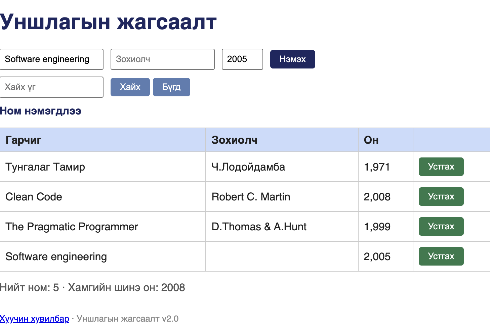
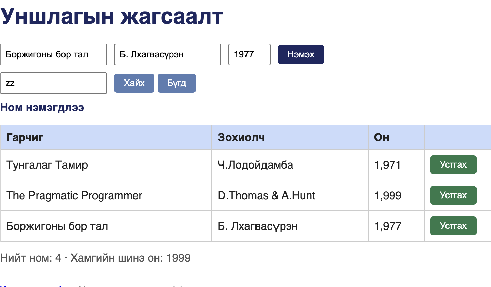

# BUG-01: «Нийт ном» тоолуур хүснэгтийн мөрийн тооноос үргэлж 1-ээр их байна

Орчин:  Уншлагын жагсаалт v2.0, Google Chrome 155.0.8059.85, macOS 26.6.2, 2026-10-20
Урьдчилсан нөхцөл: `node app.js`-ийг шинээр асаасан (анхны 3 ном)

## Дахин гаргах алхам

1. http://localhost:3000 хаягийг нээнэ.
2. Хүснэгтийн мөрийг тоолно: «Тунгалаг Тамир», «Clean Code», «The Pragmatic Programmer» — нийт 3 мөр.
3. Хүснэгтийн доор байрлах «Нийт ном: N» гэсэн тоог уншина.

Хүлээгдэж байсан: Спецификацийн дүрэм 7 — «Нийт ном» тоолуур хүснэгтэд буй номын тоотой тэнцүү, өөрөөр хэлбэл «Нийт ном: 3».
Бодит үр дүн:     «Нийт ном: 4» — хүснэгтийн мөрийн тооноос 1-ээр их. Зөрүү ном нэмэх, устгах бүрд хадгалагдана: 4 мөр үед «Нийт ном: 5», 6 мөр үед «Нийт ном: 7», 3 мөр үед «Нийт ном: 4».

Ноцтой байдал: Major — хэрэглэгчид харуулж буй нэгтгэсэн тоо буруу. Хэрэглэгч жагсаалтад байхгүй нэг ном байгаа гэж ойлгох бөгөөд энэ тоог тайлан, шийдвэрт ашиглавал алдаа цааш тархана. Өгөгдөл устахгүй тул Critical биш.

Хавсралт:       · 

Олдсон аялал:  Fed-Ex (Бизнес дүүрэг) — өгөгдлийг нэмэх → хүснэгт → тоолуур гэсэн замаар мөшгиж байх үед.
