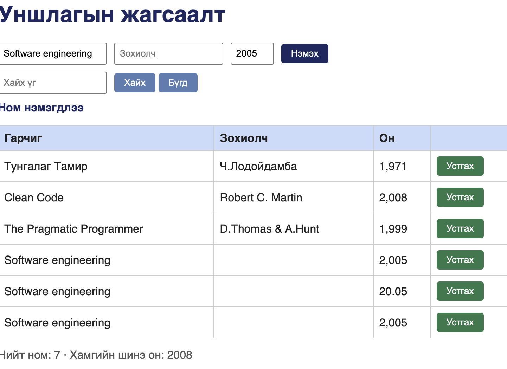

# BUG-07: Яг ижил гарчиг, зохиолчтой номыг давхардуулж нэмэх боломжтой

Орчин:  Уншлагын жагсаалт v2.0, Google Chrome 155.0.8059.85, macOS 26.6.2, 2026-10-20
Урьдчилсан нөхцөл: `node app.js`-ийг шинээр асаасан (анхны 3 ном)

## Дахин гаргах алхам

1. http://localhost:3000 хаягийг нээнэ.
2. Гарчиг `Test Book`, Зохиолч `Test Author`, Он `2000` гэж бичээд «Нэмэх» дарна. Хүснэгтэд нэмэгдэнэ.
3. Яг ижил гурван утгыг (`Test Book`, `Test Author`, `2000`) дахин бичээд «Нэмэх» дарна.

Хүлээгдэж байсан: Спецификацийн дүрэм 3 — «Ижил гарчиг, зохиолчтой ном давхардуулж нэмэгдэхгүй». Хоёр дахь нэмэлт татгалзаж, тайлбар мессеж гарах ёстой.
Бодит үр дүн:     Хоёр дахь ном мөн адил нэмэгдэж, хүснэгтэд ижил агуулгатай хоёр мөр зэрэгцэн харагдана. Татгалзсан тухай мессеж гарахгүй.

Ноцтой байдал: Major — уншлагын жагсаалтын гол утга нь нэг номыг нэг удаа бүртгэх явдал. Давхардал хуримтлагдах тусам жагсаалт, тоолуур, хайлтын үр дүн бүгд найдваргүй болно.

Хавсралт:       — session-ий үед «Software engineering» гарчигтай ном гурван удаа давхардаж нэмэгдсэн байдал.

Олдсон аялал:  Fed-Ex (Бизнес дүүрэг) — нэг өгөгдлийг нэмэх замаар дахин дахин дамжуулж байхад.
