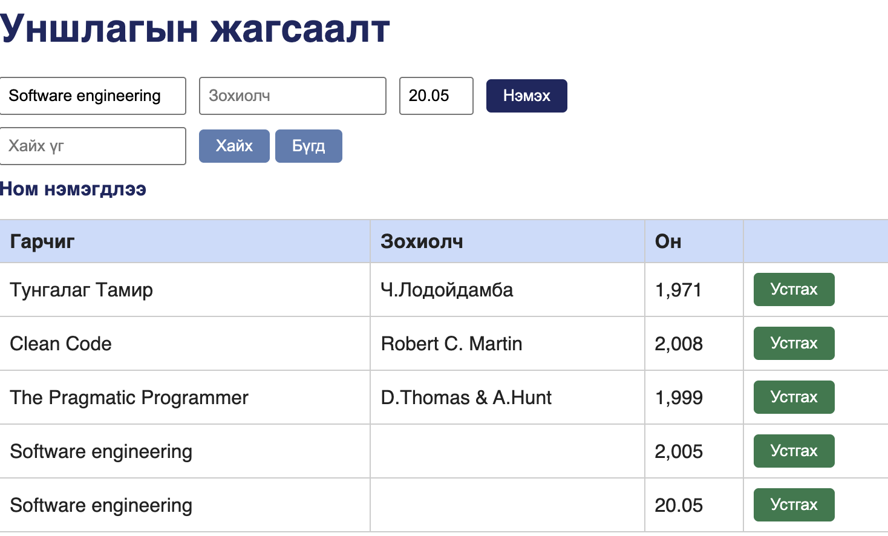
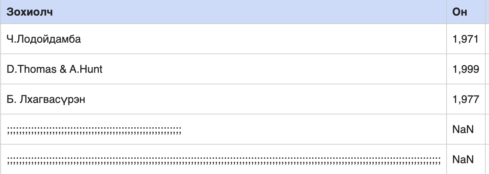

# BUG-08: Он талбар бутархай тоо, үсгийг хүлээн авч, хүснэгтэд `20.05`, `NaN` гэж харуулна

Орчин:  Уншлагын жагсаалт v2.0, Google Chrome 155.0.8059.85, macOS 26.6.2, 2026-10-20
Урьдчилсан нөхцөл: `node app.js`-ийг шинээр асаасан (анхны 3 ном)

## Дахин гаргах алхам

1. http://localhost:3000 хаягийг нээнэ.
2. Гарчиг `Decimal Test`, Зохиолч `Tester`, Он талбарт `20.05` гэж бичээд «Нэмэх» дарна.
3. Хүснэгтийн сүүлийн мөрийн «Он» баганыг уншина.
4. Дараа нь Гарчиг `Letter Test`, Зохиолч `Tester`, Он талбарт `abcd` гэж бичээд «Нэмэх» дарна.
5. Хүснэгтийн сүүлийн мөрийн «Он» баганыг дахин уншина.

Хүлээгдэж байсан: Спецификацийн дүрэм 2 — «Он нь 1000-2100 хоорондох БҮХЭЛ ТОО». `20.05` ч, `abcd` ч энэ нөхцөлийг хангахгүй тул ном нэмэгдэхгүй, алдааны мессеж гарах ёстой.
Бодит үр дүн:     Алхам 2-т ном нэмэгдэж, «Он» баганад `20.05` гэж яг тэр хэвээр харагдана. Алхам 4-т ном мөн нэмэгдэж, «Он» баганад `NaN` гэж харагдана. Аль ч тохиолдолд алдааны мессеж гарахгүй.

Ноцтой байдал: Major — оны мужийн болон төрлийн баталгаажуулалт огт хийгдэхгүй байна. `NaN` нь хэрэглэгчид утгагүй техникийн утга бөгөөд эрэмбэлэлт, «Хамгийн шинэ он» зэрэг тооцоололд цааш нөлөөлнө.

Хавсралт:       · 

Олдсон аялал:  Fed-Ex (Бизнес дүүрэг) — оны утга оролтоос хүснэгт хүртэл хэрхэн хадгалагдаж, харагдаж байгааг мөшгиж байхад.
