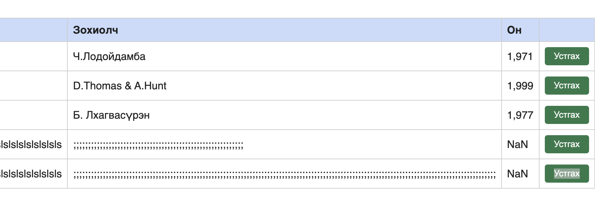

# BUG-09: Зай завсаргүй урт гарчиг оруулахад хуудасны байрлал эвдэрч, хүснэгт дэлгэцээс халина

Орчин:  Уншлагын жагсаалт v2.0, Google Chrome 155.0.8059.85, macOS 26.6.2, 2026-10-20
Урьдчилсан нөхцөл: `node app.js`-ийг шинээр асаасан (анхны 3 ном)

## Дахин гаргах алхам

1. Терминалд дараах командыг ажиллуулж 300 тэмдэгтийн зай завсаргүй мөрийг санах ойд хуулна:

```
printf 'A%.0s' {1..300} | pbcopy
```

2. http://localhost:3000 хаягийг нээнэ.
3. Гарчиг талбарт `Cmd+V` дарж хуулсан текстийг буулгана.
4. Зохиолч `Tester`, Он `2000` гэж бичээд «Нэмэх» дарна.
5. Хуудсыг ажиглана.

Хүлээгдэж байсан: Спецификацийн дүрэм 6 — «хүснэгт ямар ч урттай оролтод эвдрэхгүй». Урт текст таслагдах, мөр шилжих эсвэл нүдэн дотроо багтах ёстой.
Бодит үр дүн:     Хүснэгт нийт хуудсыг баруун тийш сунгаж, хэвтээ гүйлтийн зураас гарна. Гүйлгэсэн үед «Гарчиг» багана, дээд талын гарчиг болон ном нэмэх форм дэлгэцээс гарч алга болно — өөрөөр хэлбэл үндсэн удирдлагууд харагдахаа болино.

Ноцтой байдал: Minor — өгөгдөл алдагдахгүй бөгөөд гүйлгэх замаар эргэж хандах боломжтой. Гэвч нэг хэрэглэгчийн оруулсан нэг бичлэг бусад бүх хэрэглэгчийн хувьд хуудасны байрлалыг эвдэж байгаа тул зөвхөн гоо зүйн асуудал биш.

Хавсралт:      

Олдсон аялал:  Supermodel (Жуулчны дүүрэг) — хэт урт оролтод интерфэйс хэрхэн тэсэхийг шалгаж байхад.
