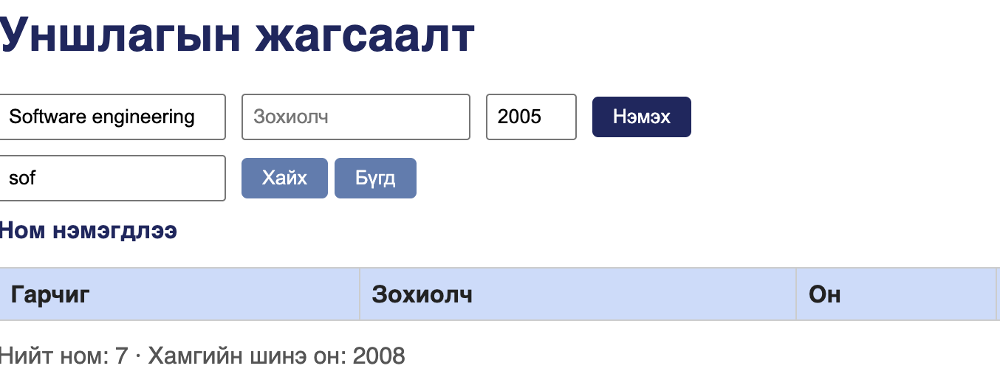
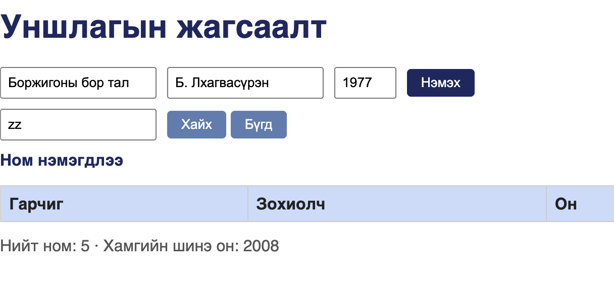
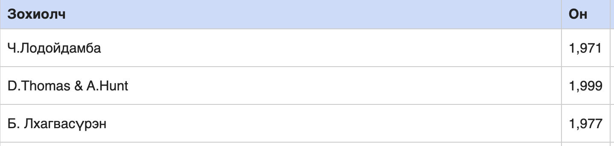
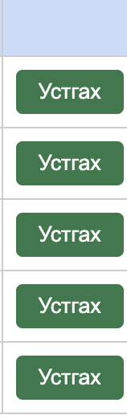

# Session report

Тестер:    Г. Нармандах (B232270057)
Огноо:     2026-10-20, 20:30 - 21:29 (59 мин)
Mission:   Уншлагын жагсаалт аппын чанарыг шинжлэх
Charter:   Судлах: ном нэмэх, хайх, устгах функц, алдааны мессеж, «Нийт ном» тоолуур.
           Ашиглан: хоосон ба дутуу талбар, хязгаараас гадуурх он, давхардсан ном,
           том/жижиг үсэг хольсон хайлтын үг, урт ба тусгай тэмдэгттэй гарчиг,
           curl-ээр илгээсэн эвдэрсэн JSON.
           Илрүүлэх: баталгаажуулалтын цоорхой, өгөгдлийн зөрүү, API-ийн буруу
           статус код, UI ба мессежийн согогууд.
Аялалууд:  Couch Potato (Hotel) · Saboteur (Seedy) · Fed-Ex (Business) · Supermodel (Tourist)

## Тэмдэглэл (он цагийн дарааллаар)

**20:30** — Аппыг нээв, эхний байдлыг ажиглав. Анхны 3 ном: «Тунгалаг Тамир», «Clean Code», «The Pragmatic Programmer».

**20:31** — Он талбарыг хоосон орхиод бусдыг бөглөж илгээхэд ном нэмэгдэв.

**20:41** — Зохиолчийг хоосон орхиод, бусад хэсгийг бөглөөд илгээхэд ном нэмэгдэв. Мессеж: «Ном нэмэгдлээ» — алдааны мессеж огт гарсангүй. → [BUG-04](bugs/bug-04.md)


**20:52** — Бутархай тоогоор он оруулахад алдаа өгөлгүй нэмэгдэв. Хүснэгтэд «20.05» гэж яг тэр хэвээр харагдав. → [BUG-08](bugs/bug-08.md)


**20:55** — Он болон номын нэрний утгыг ижил өгөөд оруулахад ном дахин нэмэгдэв — давхардал шалгагдахгүй байв. → [BUG-07](bugs/bug-07.md)


**20:57** — Номны нэрний эхний үсгийг жижгээр бичиж хайхад илэрц олдсонгүй. Жагсаалтад тэр ном байсаар байв. → [BUG-03](bugs/bug-03.md)



**21:09** — curl-ээр зохиолч хоосон JSON илгээв: `{"title":"Book","author":"","year":1999}` → `HTTP/1.1 201 Created`, бие `{"result":"OK","id":10}`. Сервер ч UI-гийн адил шалгалт хийхгүй байв. Нотолгоо: [evidence/bug-04-curl.txt](evidence/bug-04-curl.txt) → [BUG-04](bugs/bug-04.md)

**21:13** — Байхгүй ном хайхад хүснэгт зөв хоосон буцсан ч дэлгэц дээрх мессеж шинэчлэгдээгүй — өмнөх «Ном нэмэгдлээ» хэвээр үлдэв.



**21:16** — Ном устгах үед мөн мессеж шинэчлэгдсэнгүй. Дээрхтэй ижил төрлийн зан төлөв гэж үзэж, тусад нь согог болгон баталгаажуулалгүй үлдээв.


**21:20** — Урт гарчиг нэмсний дараа хуудас баруун тийш халив, Гарчиг багана ба форм дэлгэцээс гарав. → [BUG-09](bugs/bug-09.md)


**21:22** — Хүснэгтийн Он багана: анхны 3 номд «1,971», «1,999», «1,977» гэж таслалтай харагдаж байв (хүлээгдсэн: 1971). → [BUG-02](bugs/bug-02.md)



**21:23** — Үсэгтэй он оруулахад мөр нэмэгдэж, Он багана «NaN» харуулав. → [BUG-08](bugs/bug-08.md)


**21:25** — Устгах товч ногоон (хүлээгдсэн: улаан). → [BUG-06](bugs/bug-06.md)



**21:27** — [Saboteur] curl-ээр гурван буруу бие илгээв:

```
ene bol JSON bish                          → HTTP/1.1 200 OK   {"result":"OK"}
{"title":"A","author":"B",   (хаагдаагүй)  → HTTP/1.1 200 OK   {"result":"OK"}
{"title":123,"author":true,"year":"abcd"}  → HTTP/1.1 201 Created  id:15
```

Гурвуулаа 400 буцаах ёстой байв. Нотолгоо: [evidence/bug-05-curl.txt](evidence/bug-05-curl.txt), [evidence/bug-05b-curl.txt](evidence/bug-05b-curl.txt), [evidence/bug-08-curl.txt](evidence/bug-08-curl.txt) → [BUG-05](bugs/bug-05.md)

**21:29** — Нотолгоогоо эргэж нягтлахад хүснэгтийн мөрийн тоо болон «Нийт ном» тоолуур гурван удаа зөрсөн байв: 4 мөр / «Нийт ном: 5», 6 мөр / «Нийт ном: 7», 3 мөр / «Нийт ном: 4» — үргэлж 1-ээр их. → [BUG-01](bugs/bug-01.md)


**21:29** — Session дуусав.

## Саадууд (issues)

- Аппын мессеж үйлдэл бүрийн дараа шинэчлэгддэггүй: хайлт, устгалтын дараа ч «Ном нэмэгдлээ» гэсэн өмнөх мессеж дэлгэц дээр үлдэж байв. Энэ нь аль үйлдлийн хариу харагдаж байгааг ялгахад саад болсон тул ажиглалт бүрийг хүснэгтийн бодит агуулгаар давхар шалгах шаардлагатай болов.
- Эхний curl туршилтуудыг `tee`-гүй ажиллуулсан тул гаралт файлд хадгалагдаагүй; session-ий дараа аппыг шинээр асааж нотолгоог дахин авсан.

## Цагийн задаргаа

Setup 7% · Тест дизайн ба гүйцэтгэл 73% · Согог судлах 20%
